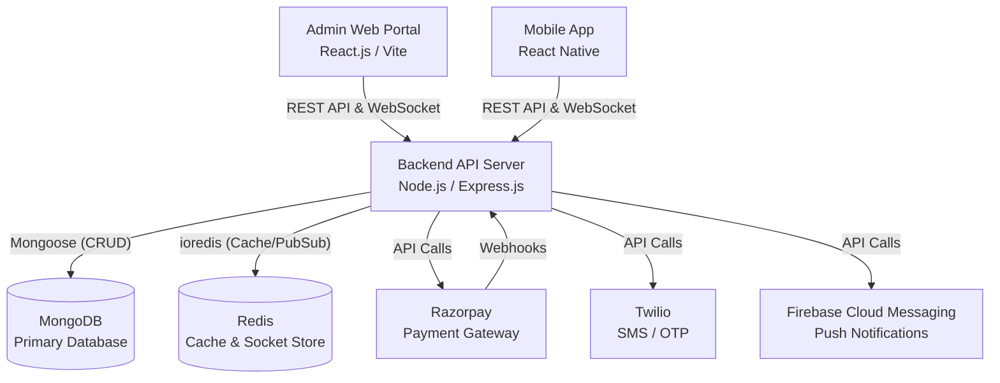
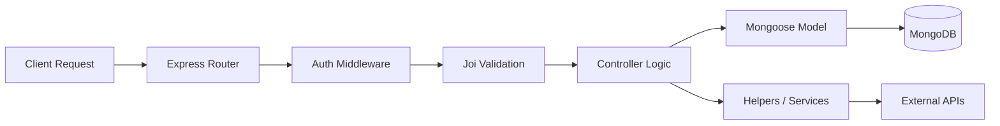
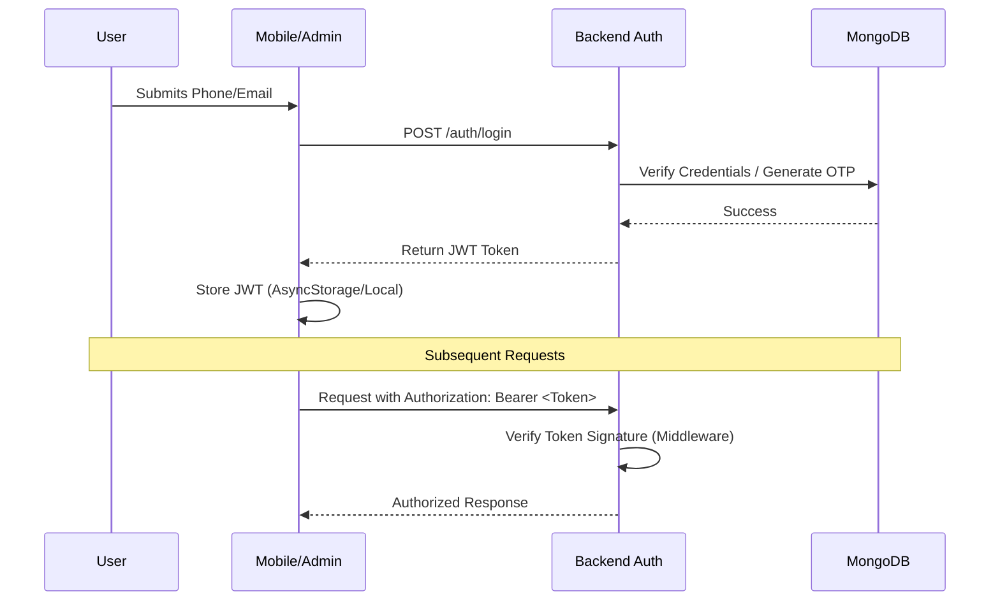
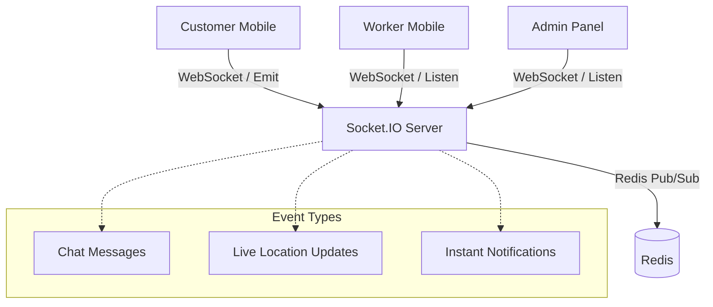

# Architecture Document: Kwickly

This document outlines the complete architectural design of the Kwickly platform, derived from the repository structure and dependencies mapping. It includes detailed breakdowns of frontend, backend, and external service layers, alongside interaction flow diagrams.

---

## High-Level System Architecture

The Kwickly platform is built on a client-server model utilizing RESTful APIs and WebSockets for real-time communication.

---

## 1. Frontend Architecture (Admin)

The Admin panel is a Single Page Application (SPA) built with React.js and Vite.
*   **Routing**: Handled by `react-router-dom` to serve distinct feature modules (e.g., `/dashboard`, `/users`, `/orders`).
*   **State Management**: Context API (`ThemeContext.jsx`) is used for global configurations, while local state handles UI interactions.
*   **Component Pattern**: Follows a strict composition pattern. `src/modules/` contain intelligent container components, while `src/components/` contain dumb reusable presentation components (Badges, Cards, Tables).
*   **API Layer**: Centralized via `src/services/api.js` utilizing Axios interceptors to automatically append JWT tokens to outgoing requests and handle 401 Unauthorized responses.

## 2. Backend Architecture

The Backend relies on a modular, domain-driven Express.js architecture.

*   **Request Lifecycle**: Client -> Routes -> Auth/Role Middlewares -> Joi Validator -> Controller -> Mongoose Model -> Database.
*   **Modularity**: Each domain (e.g., `job`, `shop`, `auth`) encapsulates its own routes, controllers, and models. This prevents tightly coupled spaghetti code and aligns with Domain-Driven Design (DDD).
*   **Error Handling**: Centralized through `error.middleware.js` to ensure consistent JSON error shapes across all endpoints.

## 3. Mobile Architecture

The mobile application is a cross-platform React Native app utilizing `react-navigation`.

*   **Role-Based Navigation Trees**: Uses distinct navigation stacks based on user roles (CustomerTabs, ShopTabs, WorkerTabs) handled in `src/app/navigation`.
*   **Feature Modules**: Grouped tightly by persona in `src/features/`. Each feature contains the screens applicable to that persona.
*   **Global Contexts**: `AuthContext.js` tracks the signed-in user, `CartContext.js` tracks shop orders, and `NotificationContext.js` processes background FCM messages.
*   **Services Layer**: Separated API calls (e.g., `authService.js`, `shopService.js`) abstract away Axios logic from UI components.

## 4. Shared Modules

While the repositories are distinct, they share conceptual modules:
*   **API Contracts**: The data structures returned by the backend Mongoose models dictates the PropTypes and TypeScript interfaces implicitly used on Admin and Mobile.
*   **WebSocket Events**: Both Admin and Mobile utilize `socket.io-client` and share the same event namespace generated by the backend's `src/sockets/index.js`.

## 5. Authentication Architecture

Authentication is JWT (JSON Web Token) based and stateless on the backend.

## 6. Authorization Architecture

Authorization determines *what* an authenticated user can do.
*   **Role-Based Access Control (RBAC)**: Managed via `src/middleware/role.middleware.js`. 
*   **Roles**: `admin`, `customer`, `worker`, `shop`.
*   **Enforcement**: The router defines access policies (e.g., `router.post('/create', auth, authorizeRoles('admin'), controller.create)`).

## 7. API Architecture

*   **Style**: RESTful.
*   **Payloads**: Standardized JSON responses controlled by `src/helpers/response.helper.js`.
*   **Rate Limiting**: Applied via `express-rate-limit` in `rateLimit.middleware.js` to prevent brute force and DDoS attacks.
*   **Validation**: Every incoming body, query, and param is sanitized and validated using Joi schemas (`src/validators/`) before reaching the controller.

## 8. Database Architecture

*   **Database**: MongoDB configured via `src/config/db.js`.
*   **ODM**: Mongoose.
*   **Schema Design**: Relational patterns are emulated using `ObjectId` references (`ref`) across collections (e.g., A `Job` document references a `Customer` and a `Worker`).
*   **Indexes**: Leveraged within schemas to optimize frequent queries (e.g., geospatial indexes for shop/worker location lookups).

## 9. Redis Architecture

*   **Client**: `ioredis`.
*   **Use Cases**:
    *   **Caching**: Storing frequently accessed, rarely changing data (e.g., service categories).
    *   **OTP Storage**: Fast, transient storage for OTPs during the login flow with native TTL (Time-To-Live) expiration.
    *   **Socket Adapter**: Used to scale `socket.io` across multiple Node.js instances if deployed in a cluster.

## 10. Socket Architecture

Handles live interactions like real-time tracking, chat, and live bids.

## 11. Queue Architecture

Background tasks that are intensive or require retries are decoupled from the main request thread.
*   **Mechanism**: Uses Node-cron (`src/workers/cronEngine.js`) combined with script executions.
*   **Use Cases**: Subscription renewals, checking unread notifications (`check_notifs.js`), expiring stale bids, or database cleanup routines.

## 12. Notification Architecture

*   **Channels**: In-App (Websockets), Push Notifications (FCM), and SMS (Twilio).
*   **Flow**: Controller triggers `notifyUser.helper.js` -> Helper stores notification in MongoDB (`notification.model.js`) -> Emits live socket event -> Pushes FCM payload to offline devices.

## 13. Deployment Architecture

While deployment files (like Dockerfiles) aren't explicitly present in the mapped tree, the structure implies:
*   **Backend**: Deployed on a Node.js runtime (e.g., AWS EC2, Heroku, or Docker container). Requires Node >= 22.11.0.
*   **Admin**: Compiled via `vite build` to static HTML/JS/CSS assets. Deployed to a CDN or static host (S3, Vercel, Netlify).
*   **Mobile**: Compiled to APK/AAB for Android (via Gradle) and IPA for iOS (via Xcode/CocoaPods) and distributed via App Stores.

## 14. How Every Module Communicates

The system relies on highly decoupled, internal API boundaries:
1.  **Mobile to Backend**: Asynchronous HTTP REST calls via Axios (for CRUD ops) and Socket.IO (for live streams).
2.  **Admin to Backend**: Asynchronous HTTP REST calls via Axios.
3.  **Backend Inter-module (Internal)**: Controllers rely on Mongoose Models. They do not directly call other controllers. If the `Job` module needs `Customer` data, it populates it via Mongoose `populate()`.
4.  **Backend to External**: The backend acts as an orchestrator. It uses specific helpers (e.g., `razorpay.helper.js`, `sms.service.js`) to interact securely with external SaaS providers, parsing their responses before mutating the MongoDB state.
