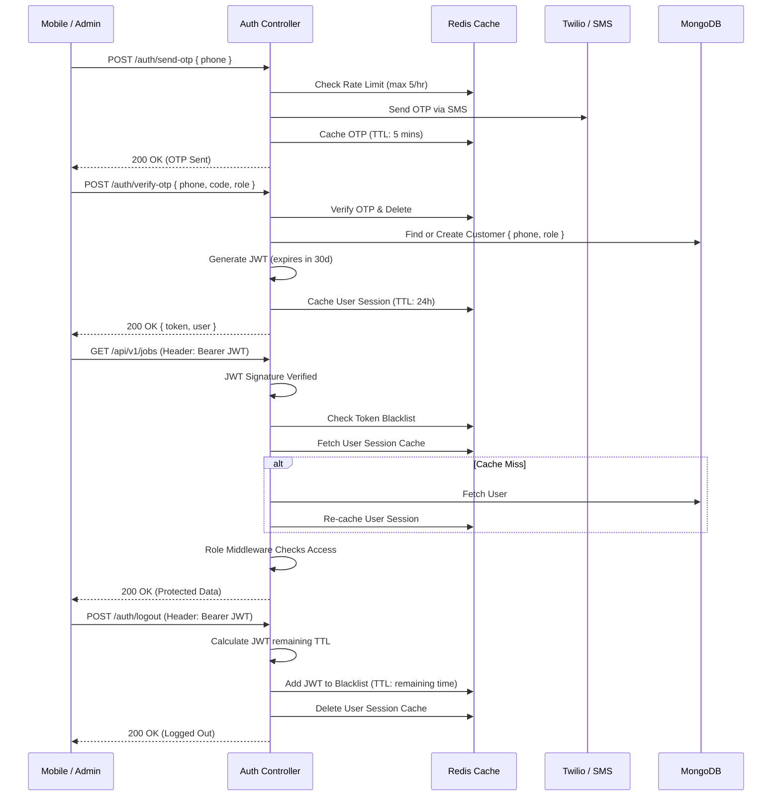

# Kwickly Authentication Architecture

This document outlines the authentication and authorization mechanisms used across the Kwickly platform, detailing token lifecycles, session management, and role-based access control.

---

## 1. Authentication Flow Diagram

---

## 2. Core Concepts

### JSON Web Tokens (JWT)
*   **Structure**: The payload contains the user's `id` and `role`. 
*   **Signature**: Signed using HMAC SHA256 against `process.env.JWT_SECRET`.
*   **Expiration**: Default is set to 30 days (`JWT_EXPIRES_IN`).

### Refresh Tokens
*   **Implementation**: Kwickly *does not* use a dedicated Short-Lived Access Token + Long-Lived Refresh Token rotation pattern. 
*   **Alternative**: It utilizes a single, medium-lived JWT (30 days) paired with a robust server-side invalidation mechanism (Blacklisting) via Redis.

### OTP (One-Time Password)
*   **Primary Auth**: The primary method for mobile users (Customers and Workers).
*   **Security**: OTPs are generated, cached in Redis with a strict 5-minute TTL (`otp:{phone}`), and then sent via SMS.
*   **Rate Limiting**: Limits OTP generation to 5 attempts per hour per phone number to prevent SMS toll fraud and brute forcing.

### Password
*   **Fallback / Admin Auth**: Users can set a password via `/auth/set-password`.
*   **Security**: Hashed using `bcryptjs` with a cost factor of 12 before being saved to MongoDB.
*   **Recovery**: Employs an OTP-based password reset flow (`/auth/forgot-password`).

---

## 3. Session Management

Instead of querying the MongoDB `Customer` collection on every authenticated request, the system uses a **Redis-first session architecture**:
1.  When a user logs in, their profile document is stringified and cached in Redis under `session:{userId}` for 24 hours.
2.  The `authMiddleware` checks Redis first.
3.  On a cache hit, it attaches the parsed JSON object to `req.user`.
4.  On a cache miss (e.g., cache evicted or expired), it falls back to MongoDB, fetches the user, and repopulates the Redis cache.

Whenever a user's critical data updates (e.g., paying for a job, changing a password, admin banning), the specific controller calls `delCache('session:{userId}')` to force a cache miss and refresh the state on the next request.

---

## 4. Token Lifecycle & Blacklisting

Because JWTs are stateless, they cannot be natively "logged out" before their expiration date. Kwickly solves this using a **Redis Blacklist**:
*   When a user logs out, the backend decodes the JWT to find its expiration timestamp.
*   It calculates the remaining time-to-live (TTL).
*   The token string is added to Redis (`blacklist:{token}`) with the exact remaining TTL.
*   The `authMiddleware` intercepts every incoming request and checks if the provided token exists in the blacklist. If it does, a `401 Unauthorized` is returned.

---

## 5. Authorization (Permissions)

### Role Validation
Accounts are strictly segregated by role. Even if a user owns a phone number, logging in as a `WORKER` and a `CUSTOMER` creates two distinct records in the database.
*   Roles: `ADMIN`, `CUSTOMER`, `WORKER`, `SHOP`.

### Permission Middleware
The `role.middleware.js` exports an `authorize(...roles)` function.
*   **Usage**: Placed in route definitions after `authMiddleware`.
*   **Example**: `router.post('/jobs', authMiddleware, authorize('CUSTOMER'), controller.createJob);`
*   If `req.user.role` is not in the allowed array, the request is immediately rejected with a `403 Forbidden`.

---

## 6. Security Summary

1.  **Stateless yet Revocable**: Combining JWTs with Redis blacklists gives the scalability of stateless auth with the security of stateful sessions.
2.  **Rate Limiting**: Both global API rate limits and specific OTP generation limits prevent brute-force attacks.
3.  **Role Segregation**: Users cannot switch their role context without explicit re-authentication, preventing privilege escalation.
4.  **Database Protection**: Heavy traffic is absorbed by the Redis session cache, protecting the MongoDB cluster from being hammered by repetitive authentication lookups.
