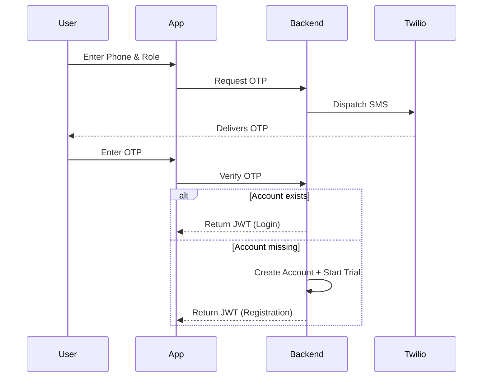
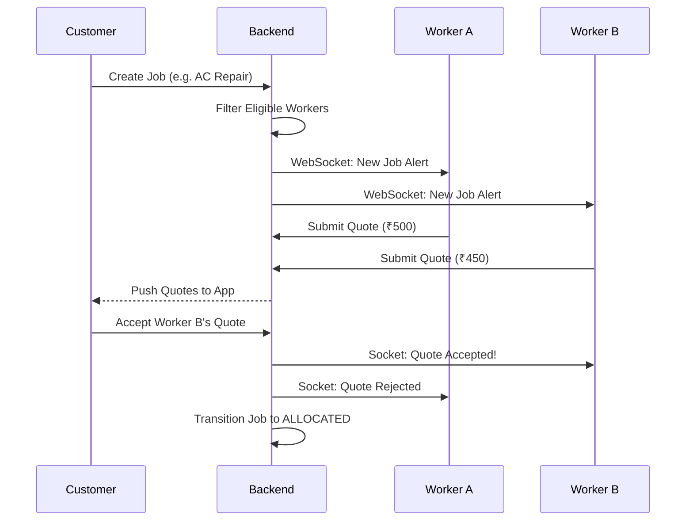
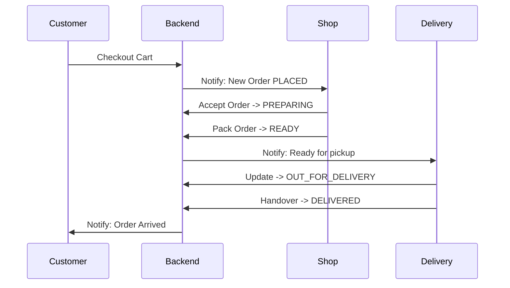

# Kwickly Business Workflows

This document details the step-by-step business logic for the core operations of the Kwickly platform. It explains how users, workers, shops, and admins interact through the lifecycle of a service or product.

---

## 1. Registration & Login

Kwickly uses a unified OTP-based flow for both registration and login, ensuring frictionless onboarding.

**Steps:**
1.  **Request**: User enters their phone number and selects their persona (Customer, Worker, Shop).
2.  **OTP Generation**: The backend validates the phone, rate-limits the request, caches an OTP in Redis, and sends an SMS via Twilio.
3.  **Verification**: User submits the OTP.
4.  **Routing**: 
    *   If the phone + role exists, it's a **Login**.
    *   If the phone + role does not exist, it's a **Registration**. The backend creates a new profile in MongoDB. (If the role is Worker or Shop, a 14-day free trial subscription is automatically applied).
5.  **Session**: The backend issues a 30-day JWT, caches the user session in Redis, and returns the token to the client.

---

## 2. Service Booking & Worker Assignment

This is the core gig-economy workflow, utilizing a reverse-bidding system where workers quote on broadcasted jobs.

**Steps:**
1.  **Booking**: A Customer selects a Service Category, specifies location coordinates, time slot, and description.
2.  **Validation**: System checks if the Customer has fewer than 5 active jobs.
3.  **Broadcasting**: The job is created in `BROADCASTING` status.
4.  **Worker Filtering**: The backend queries MongoDB for Workers who:
    *   Have the requested category active.
    *   Are currently `isOnline`.
    *   Have an approved KYC and valid Subscription.
    *   Have a wallet balance > ₹100.
    *   Are physically within their defined service radius of the job location.
5.  **Alerting**: Eligible workers receive a real-time WebSocket alert (`NEW_JOB_ALERT`).
6.  **Quoting**: Workers review the job and submit a Quote (Bid Amount).
7.  **Assignment**: The Customer reviews received quotes and clicks "Accept" on one. 
8.  **Allocation**: The Job transitions to `ALLOCATED`. The chosen Worker receives a notification, and all other quotes are marked `REJECTED`.

---

## 3. Job Execution & Payment

**Steps:**
1.  **Arrival**: The Worker arrives at the Customer's location.
2.  **Start Job**: To transition the job to `IN_PROGRESS`, the Worker must input an `Arrival OTP` provided by the Customer. The backend simultaneously verifies the Worker's GPS coordinates against the Job's coordinates (Haversine distance < 200m) to prevent GPS spoofing.
3.  **Completion**: The Worker finishes the task, uploads proof media, and marks the job `COMPLETED`.
4.  **Payment**: The Customer pays via Cash or Online (Razorpay).
    *   **Cash**: The Customer hands cash to the Worker. The backend deducts Kwickly's Platform Fee + GST from the *Worker's virtual wallet*.
    *   **Online**: The payment goes to Kwickly. The backend credits the Worker's virtual wallet with the (Total - Platform Fee).
5.  **Closure**: The Job transitions to `PAID`. Both parties can now leave Ratings.

---

## 4. E-Commerce: Order Creation to Delivery

This workflow covers the localized marketplace feature allowing Customers to buy from nearby Shops.

**Steps:**
1.  **Product Purchase**: Customer adds Products from a specific Shop to their Cart.
2.  **Order Creation**: Customer checks out. The Cart is cleared, and a `ShopOrder` is created in `PLACED` status.
3.  **Payment**: Customer pays via Razorpay or selects COD.
4.  **Shop Approval**: The Shop owner receives an alert, reviews the order, and changes the status to `PREPARING` (thereby accepting the order).
5.  **Dispatch**: Once packed, the Shop marks the order `READY_FOR_DELIVERY`.
6.  **Delivery**: The Shop's delivery staff (or the Shop owner) marks it `OUT_FOR_DELIVERY` and eventually `DELIVERED` upon handover.

---

## 5. Cancellation & Refunds

**Cancellation:**
*   Customers can cancel a Job if it is in `BROADCASTING` or `ALLOCATED` state. Once a Worker is `IN_PROGRESS`, cancellation is restricted to Admins.
*   Upon cancellation, the job/order status becomes `CANCELLED`.
*   WebSockets fire instantly to notify the assigned Worker/Shop to stand down.

**Refunds & Disputes:**
*   If a Customer pays online but the Job/Order fails, or if a Worker reports a "Partial Cash Payment", the entity is moved to `DISPUTED`.
*   An Admin reviews the dispute via the Admin Panel.
*   The Admin can trigger a manual refund (via Razorpay Dashboard or Wallet Credit API) and transition the entity to `CLOSED` or `CANCELLED`.

---

## 6. Notifications

Kwickly utilizes a triple-redundancy notification strategy to ensure high deliverability:
1.  **Database (Persistent)**: Every alert is saved to the `Notification` collection to populate the in-app Bell icon history.
2.  **WebSocket (In-App)**: If the user has the app open, the event is emitted directly to their personal Socket.io room (e.g., `worker_123`) for sub-second UI updates.
3.  **FCM (Push)**: If the user is offline or the app is backgrounded, a payload is sent to Firebase Cloud Messaging to wake the device with a banner alert.

---

## 7. Reports & Analytics

The backend aggregates data for the Admin Dashboard and Ledger.
*   **Real-time Stats**: Endpoints like `/admin/stats` run MongoDB aggregation pipelines to calculate `totalRevenue`, `activeJobs`, and `topWorkers` dynamically based on date ranges (Week, Month, Year).
*   **Performance**: To prevent database exhaustion, these heavy aggregations are cached in Redis. The cache is automatically invalidated when critical entities (like a completed Job or a new user registration) are created.
