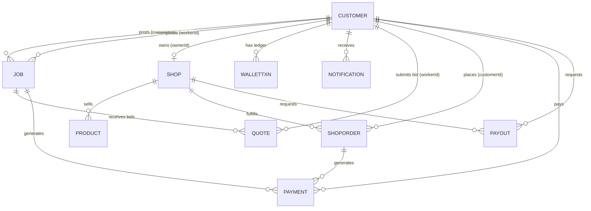

# Kwickly Database Documentation

This document provides a comprehensive analysis of the MongoDB data models powering Kwickly. It covers the schema designs, indexes, relationships (via Mongoose `ObjectId` references), and core business constraints.

---

## 1. Entity-Relationship (ER) Diagram

*Note: Since MongoDB is a NoSQL document database, these "relationships" represent Mongoose `ref` populations rather than strict SQL foreign keys.*

---

## 2. Model Analysis

### 2.1 Customer Model (`customer.model.js`)
*   **Purpose**: The central user identity table. Stores authentication, profile, KYC, and wallet data for all user types.
*   **Relationships**: `ref` target for almost every other model in the system.
*   **Foreign Keys**: `services.category` references `Category`.
*   **Indexes**: 
    *   Unique on `phone` and `email`.
    *   2dsphere index on `activeLocation.coordinates` for geospatial queries.
    *   Index on `role` and `isOnline` for fast worker lookups.
*   **Constraints**: `role` must be enum `['CUSTOMER', 'WORKER', 'ADMIN', 'SHOP']`.
*   **Soft Delete**: Implicit via `isBanned` flag (prevents login but retains data).
*   **Audit Fields**: `createdAt`, `updatedAt` (Mongoose timestamps).
*   **Business Rules**: If `role === 'WORKER'`, `kyc` array must be populated and verified before `isOnline` can be toggled to true.

### 2.2 Job Model (`job.model.js`)
*   **Purpose**: Represents a service request created by a customer and assigned to a worker.
*   **Relationships**:
    *   `customerId` -> `Customer`
    *   `workerId` -> `Customer` (only after allocation)
*   **Indexes**:
    *   2dsphere on `location`.
    *   Compound indexes: `{ customerId: 1, createdAt: -1 }`, `{ workerId: 1, createdAt: -1 }`, `{ status: 1, createdAt: -1 }`.
*   **Constraints**: `status` enum (`BROADCASTING`, `ALLOCATED`, `IN_PROGRESS`, `COMPLETED`, `PAID`, `CANCELLED`).
*   **Soft Delete**: Jobs are marked as `CANCELLED` rather than deleted from the DB.
*   **Audit Fields**: Timestamps + `broadcast.lastAttemptAt`, `completionDetails.completedAt`.
*   **Business Rules**: Only one active worker can be assigned. Maximum of 5 concurrent active jobs per customer.

### 2.3 Shop Model (`shop.model.js`)
*   **Purpose**: Stores vendor profiles for the e-commerce side of Kwickly.
*   **Relationships**: `ownerId` -> `Customer` (unique 1:1 constraint).
*   **Indexes**: 
    *   2dsphere on `location`.
    *   Index on `kyc.status`.
*   **Constraints**: Must have a valid `ownerId`.
*   **Business Rules**: Shops cannot process orders if `isActive` is false or `kyc.status` is not `APPROVED`.

### 2.4 Product Model (`product.model.js`)
*   **Purpose**: Inventory items tied to a specific shop.
*   **Relationships**: `shopId` -> `Shop`.
*   **Indexes**: `{ shopId: 1 }`, `{ isActive: 1 }`.
*   **Constraints**: Price must be >= 0.
*   **Soft Delete**: `isActive: false` (hides product without deleting historical order references).

### 2.5 ShopOrder Model (`shoporder.model.js`)
*   **Purpose**: E-commerce transactions.
*   **Relationships**:
    *   `shopId` -> `Shop`
    *   `customerId` -> `Customer`
    *   `items.productId` -> `Product`
*   **Indexes**: Compound `{ shopId: 1, status: 1, createdAt: -1 }`.
*   **Business Rules**: Reduces product stock on creation. Handles fulfillment lifecycle from `PLACED` to `DELIVERED`.

### 2.6 Wallet Model (`wallet.model.js`)
*   **Purpose**: Immutable financial ledger. Tracks every debit and credit.
*   **Relationships**: `userId` -> `Customer`.
*   **Indexes**: `{ userId: 1, createdAt: -1 }`, `{ type: 1, createdAt: -1 }`.
*   **Constraints**: No modifications allowed after creation (append-only ledger).
*   **Business Rules**: Balances in the `Customer` document are derived/updated concurrently with `WalletTxn` creation using MongoDB transactions.

### 2.7 Quote Model (`quote.model.js`)
*   **Purpose**: Bids submitted by workers for a specific broadcasted job.
*   **Relationships**: `jobId` -> `Job`, `workerId` -> `Customer`.
*   **Indexes**: Unique compound index `{ jobId: 1, workerId: 1 }` filtered by `status: ['PENDING', 'ACCEPTED']`.
*   **Constraints**: Prevents the same worker from bidding on the same job twice.
*   **Business Rules**: When a quote is `ACCEPTED`, all other quotes for that `jobId` are marked `REJECTED`, and the Job `workerId` is populated.

### 2.8 Payout Model (`payout.model.js`)
*   **Purpose**: Withdrawal requests to transfer virtual wallet balances to real bank accounts.
*   **Relationships**: `workerId` -> `Customer`, `shopId` -> `Shop`, `txnId` -> `WalletTxn`.
*   **Indexes**: `{ status: 1 }`.
*   **Business Rules**: Deducts virtual balance immediately into an 'escrow/pending' state. If the payout fails or is rejected, a refund `WalletTxn` is generated.

### 2.9 Dispute Model (`dispute.model.js`)
*   **Purpose**: Records conflicts (e.g., partial payments, low-quality work).
*   **Relationships**: `jobId` / `orderId`, `customerId`, `workerId`.
*   **Indexes**: `{ workerId: 1 }`, `{ status: 1 }`.
*   **Business Rules**: Creating a dispute locks the associated Job/Order funds from being automatically settled to the worker/shop until an Admin resolves it.

### 2.10 Category Model (`category.model.js`)
*   **Purpose**: Taxonomy for services and products.
*   **Relationships**: Supports hierarchical structures (`parentId` -> `Category`).
*   **Business Rules**: Defines the `baseCommissionRate` dynamically per service type (e.g., Plumbing might have a 10% fee, while AC Repair has 15%).

---

## 3. General Database Standards

1.  **Strict Schema Definitions**: Mongoose `strict: true` is enforced across all models to prevent arbitrary field injections.
2.  **NoSQL Referential Integrity**: While MongoDB lacks native cascading deletes, Kwickly handles this via application logic. If a shop is banned, its products remain but are hidden via API filters.
3.  **Transactions**: The system heavily relies on `mongoose.startSession()` and `session.withTransaction()` for multi-document mutations (e.g., deducting a wallet and creating a ledger entry simultaneously).
4.  **Security/Audit**: All documents contain standard Mongoose `timestamps`. Destructive actions usually rely on state changes (e.g., `status: 'CANCELLED'`) rather than `Model.deleteOne()`, preserving an immutable audit trail.
